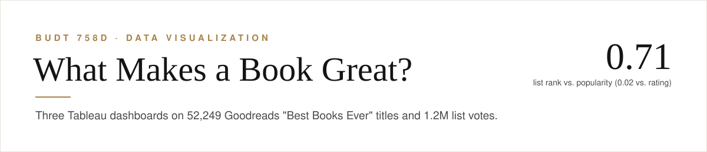
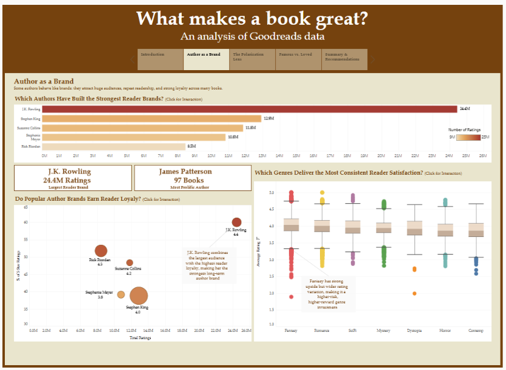
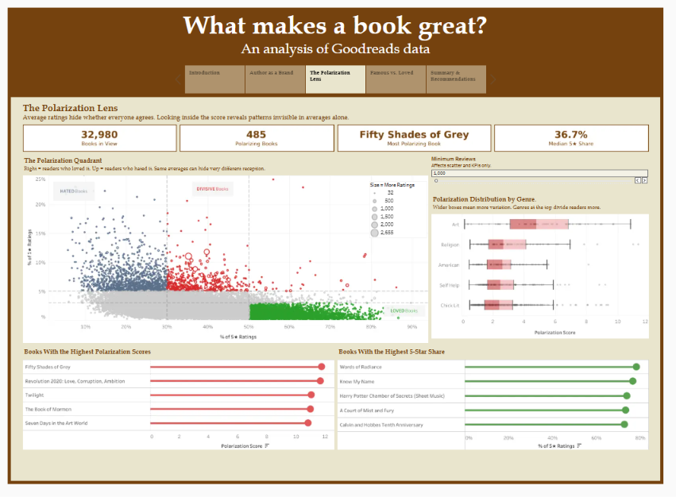
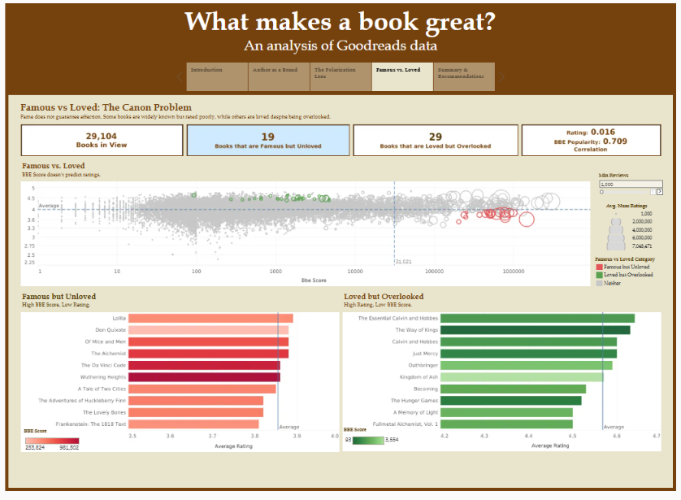
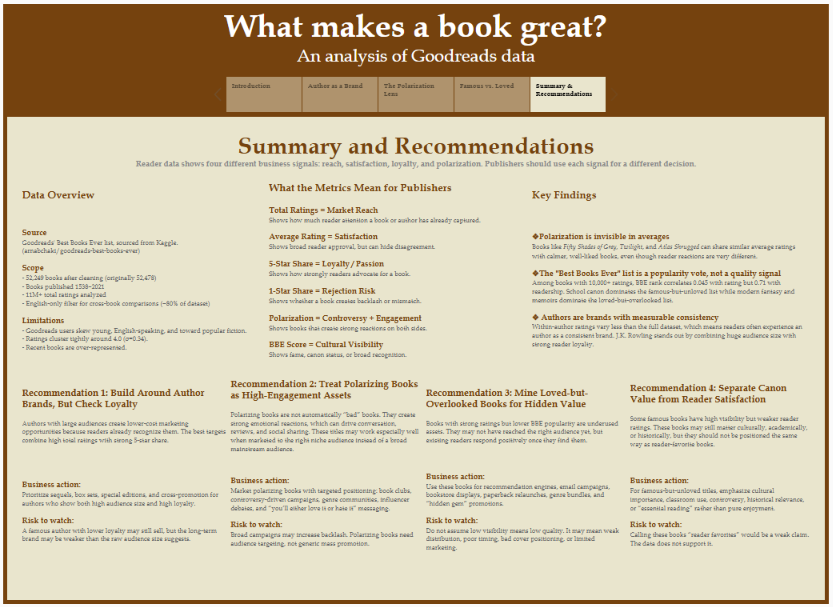

Goodreads' "Best Books Ever" list ranks 52,000+ books by reader votes. We asked whether that list, and the average star rating next to each book, actually tell you what readers love. Three dashboards, three lenses: the author, the rating, and the list itself.

**[Open the interactive dashboards on Tableau Public](https://public.tableau.com/app/profile/youngseo.chang/viz/Whatmakesabookgreat-AnanalysisofGoodreadsdata/Story)**

**Data:** [Goodreads Best Books Ever](https://www.kaggle.com/datasets/arnabchaki/goodreads-best-books-ever) (Kaggle). 52,249 books after cleaning, published 1538 to 2021, 1.18M list votes, 936M ratings.
**Team:** 4 people, BUDT 758D, University of Maryland Smith School, Spring 2026. Highest score of all teams.

---

## 1. The Author as a Brand



- 184 authors qualify as "prolific" (20+ books, 1,000+ ratings per book on average)
- J.K. Rowling has the largest audience (24.4M ratings) and the highest 5-star share among the top five, so she is the strongest brand on both axes
- James Patterson is the most prolific at 97 books
- Within-author ratings vary far less (σ = 0.18) than the dataset as a whole (σ = 0.34): readers experience an author as a consistent brand

## 2. The Polarization Lens



An average rating hides whether readers agree. Plotting 5-star share against 1-star share splits books into loved, hated, divisive, and middle ground.

- 32,980 books with 1,000+ ratings in view; 485 are polarizing (30%+ five-star and 5%+ one-star)
- Fifty Shades of Grey, Twilight, and Atlas Shrugged have average ratings close to calmly received books, but very different reception shapes
- Median 5-star share is 36.7%
- Art and Religion are the most divisive genres

## 3. Famous vs. Loved: The Canon Problem



- Position on the "Best Books Ever" list correlates **0.71 with how many people rated a book** and only **0.02 with how highly they rated it**. The list is a popularity vote, not a quality measure
- 19 books are famous but unloved (200K+ list score, rating under 3.9): mostly school canon such as Lolita, Don Quixote, Of Mice and Men
- 29 books are loved but overlooked (rating 4.4+, 100K+ ratings, list score under 5,000): mostly modern fantasy, memoirs, and comics such as The Way of Kings, Just Mercy, Calvin and Hobbes

## Recommendations



Each metric answers a different publisher question: total ratings for reach, average rating for satisfaction, 5-star share for loyalty, 1-star share for rejection risk, list score for cultural visibility. Full recommendations in the dashboard above.

---

## How it was built

**Data cleaning (Python, pandas).** From the raw Kaggle file (52,478 rows) to `data/books_clean.csv` (52,249 rows):
- Split the author field into `primary_author` and co-authors; flagged series, boxed sets, and bundle titles
- Parsed the star distribution into `pct_5_star`, `pct_1_star`, and a `polarization` score
- Derived `primary_genre` from the genre list, publication decade, and format type
- Flagged 632 books with ambiguous historical dates
- Kept non-English books in the file; cross-book comparisons use an English-only filter (81% of the data)

**Tableau.** One parameter (`Min Reviews`) drives the Polarization and Canon dashboards. Quadrant, canon-gap, and author-brand categories are calculated fields built once and reused. Clicking a quadrant, genre, category, or author filters the other charts on the same dashboard. The full build spec is in `docs/tableau_build_plan.pdf`.

**Caveats.** Goodreads users skew young, English-speaking, and toward popular fiction. Ratings cluster tightly around 4.0. Recent books are over-represented. "Anonymous" is excluded from author analysis because it groups unrelated works.

## Repository

```
dashboards/              exported dashboard images
data/books_clean.csv     cleaned dataset used by the workbook (52,249 books, 37 columns)
docs/tableau_build_plan.pdf   dashboard specification: parameters, calculated fields, charts, interactions
```

**Tools:** Tableau, Python (pandas)
