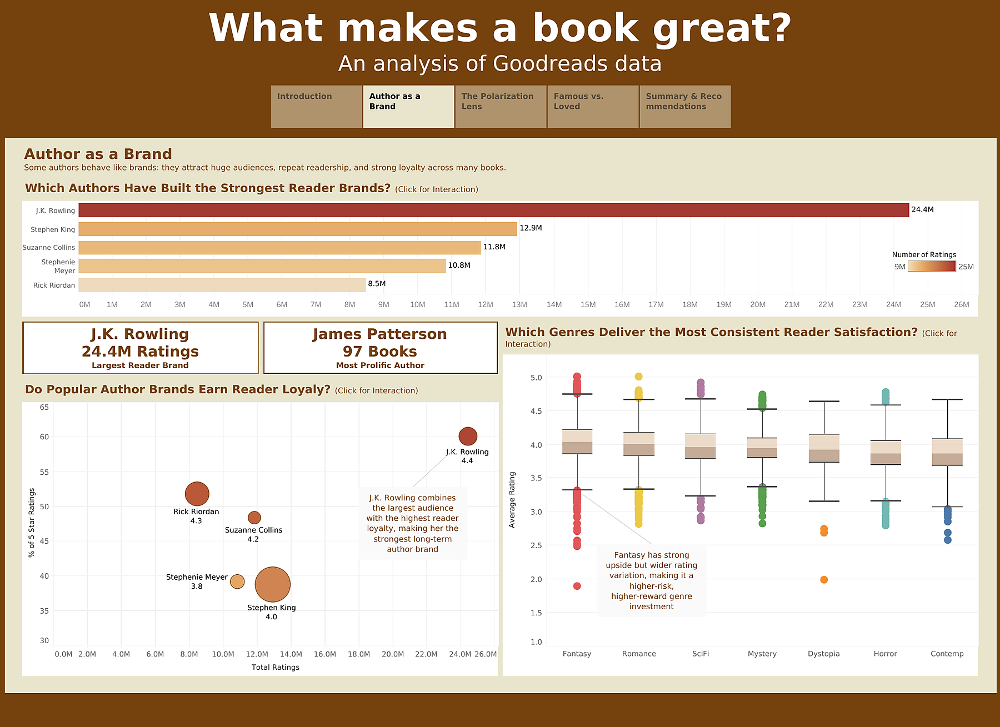
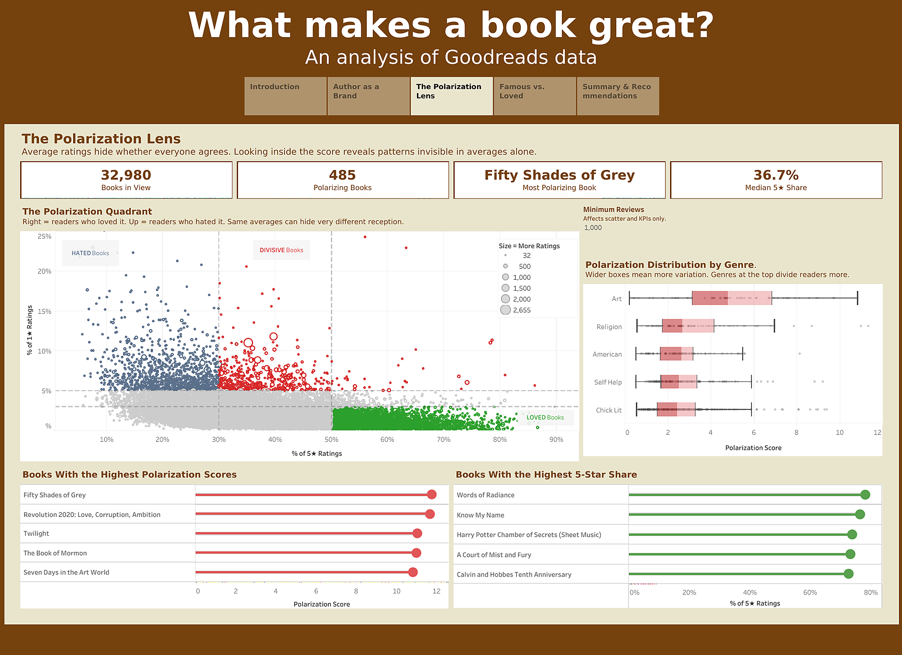
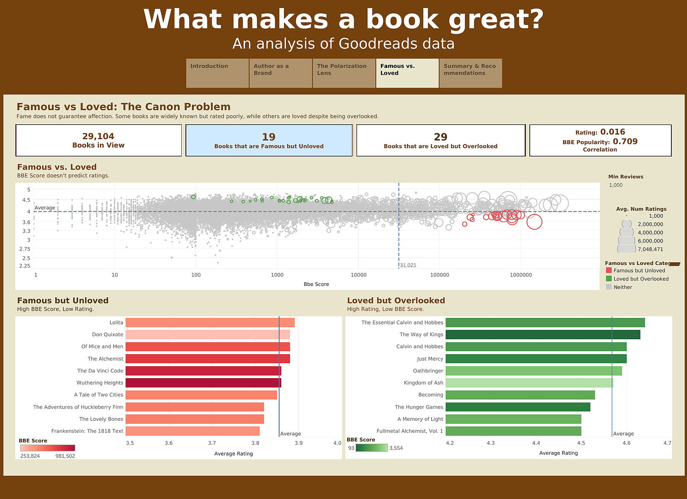
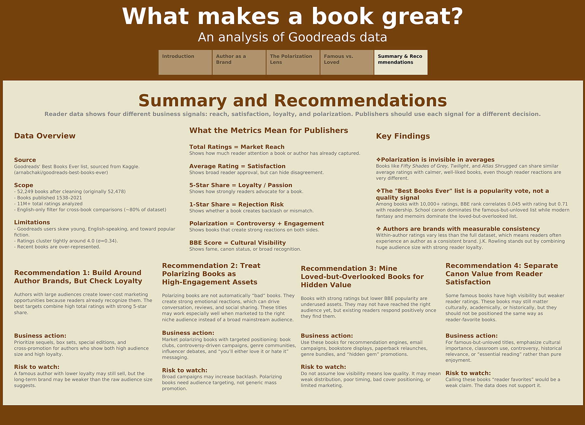

**Top score in the class, BUDT 758D Data Visualization.** Three Tableau dashboards on 52,249 Goodreads books.

Goodreads' "Best Books Ever" list ranks 52,000+ books by reader votes. Does the list, or the star rating next to each book, tell you what readers actually love? We built three Tableau dashboards to check, each looking at the same data from a different angle: the author, the rating, and the list itself.

**[Interactive dashboards on Tableau Public](https://public.tableau.com/app/profile/youngseo.chang/viz/Whatmakesabookgreat-AnanalysisofGoodreadsdata/Story)**

**Data:** [Goodreads Best Books Ever](https://www.kaggle.com/datasets/arnabchaki/goodreads-best-books-ever) on Kaggle. 52,249 books after cleaning, published 1538 to 2021, 1.18M list votes, 936M ratings.
**Course:** BUDT 758D Data Visualization, University of Maryland Smith School, Spring 2026. Team of 4. Top score in the class.

---

## 1. The Author as a Brand



- 184 authors have 20+ books averaging 1,000+ ratings each
- J.K. Rowling has the biggest audience (24.4M ratings) and the highest 5-star share of the top five
- James Patterson has the most books at 97
- Ratings within one author's books vary much less (σ = 0.18) than across the whole dataset (σ = 0.34). Readers know what they are getting from an author they already read

## 2. The Polarization Lens



A 3.8 average can mean everyone gave 4 stars, or half gave 5 and half gave 1. Plotting 5-star share against 1-star share separates the two.

- 32,980 books with 1,000+ ratings; 485 of them are polarizing (30%+ five-star and 5%+ one-star)
- Fifty Shades of Grey, Twilight, and Atlas Shrugged have averages close to books that nobody argues about
- Median 5-star share is 36.7%
- Art and Religion are the most divisive genres

## 3. Famous vs. Loved: The Canon Problem



- A book's position on the list correlates **0.71 with how many people rated it** and **0.02 with how highly they rated it**. The list measures popularity, not quality
- 19 books are famous but unloved (200K+ list score, rating under 3.9). Most are school reading: Lolita, Don Quixote, Of Mice and Men
- 29 books are loved but overlooked (rating 4.4+, 100K+ ratings, list score under 5,000). Most are recent fantasy, memoirs, and comics: The Way of Kings, Just Mercy, Calvin and Hobbes

## Recommendations



Each metric answers a different question for a publisher. Total ratings is reach. Average rating is satisfaction. 5-star share is loyalty. 1-star share is rejection risk. List score is name recognition. The dashboard above has the four recommendations.

---

## How it was built

**Cleaning (Python, pandas).** The raw Kaggle file has 52,478 rows; `data/books_clean.csv` has 52,249.
- Split the author field into `primary_author` and co-authors; flagged series, boxed sets, and bundle titles
- Turned the star distribution into `pct_5_star`, `pct_1_star`, and a `polarization` score
- Added `primary_genre` from the genre list, plus publication decade and format type
- Flagged 632 books whose dates could not be pinned down
- Non-English books stay in the file; cross-book comparisons use an English-only filter (81% of the data)

**Tableau.** One parameter (`Min Reviews`) drives the Polarization and Canon dashboards. The quadrant, canon-gap, and author-brand categories are calculated fields built once and reused across sheets. Clicking a quadrant, genre, category, or author filters the other charts on that dashboard. The build spec is in `docs/tableau_build_plan.pdf`.

**Caveats.** Goodreads users skew young, English-speaking, and toward popular fiction. Ratings bunch up around 4.0. Recent books are over-represented. "Anonymous" is left out of the author analysis because it lumps unrelated works together.

## Repository

```
dashboards/                   dashboard images
data/books_clean.csv          cleaned dataset behind the workbook (52,249 books, 37 columns)
docs/tableau_build_plan.pdf   build spec: parameters, calculated fields, charts, interactions
```

**Tools:** Tableau, Python (pandas)
